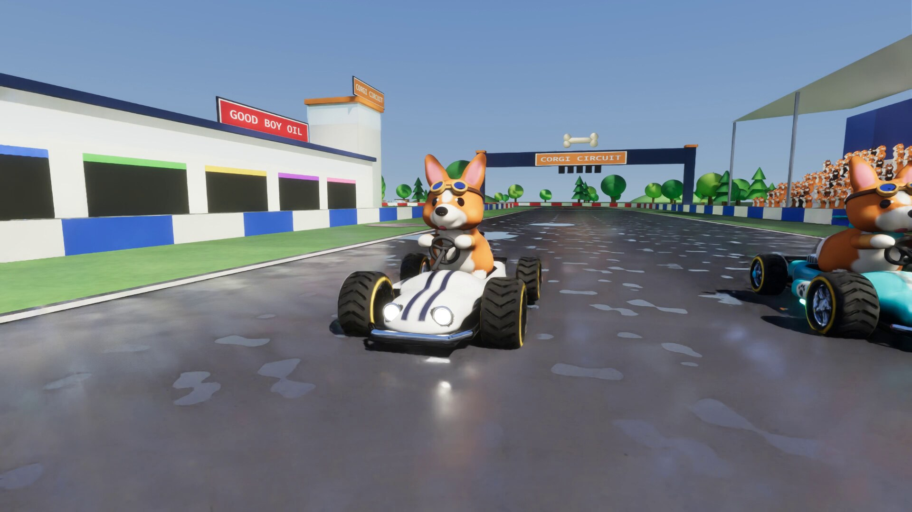
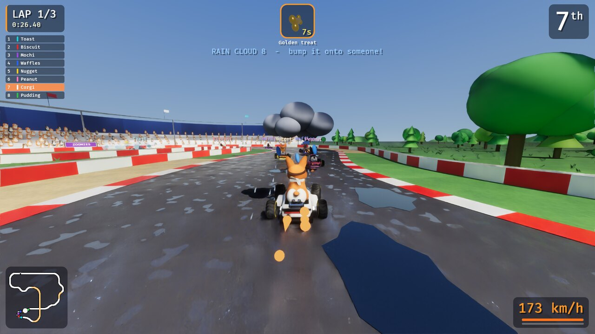
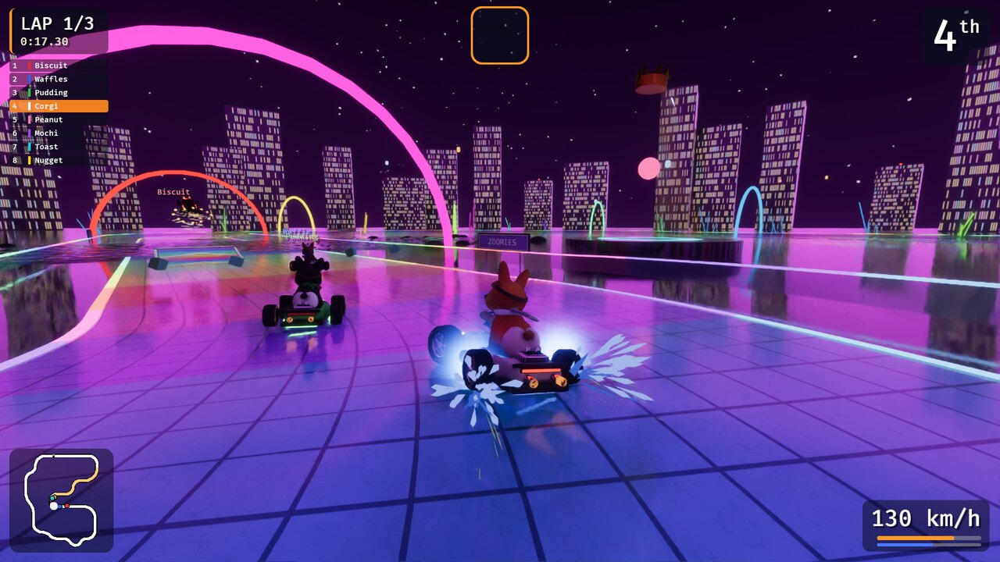
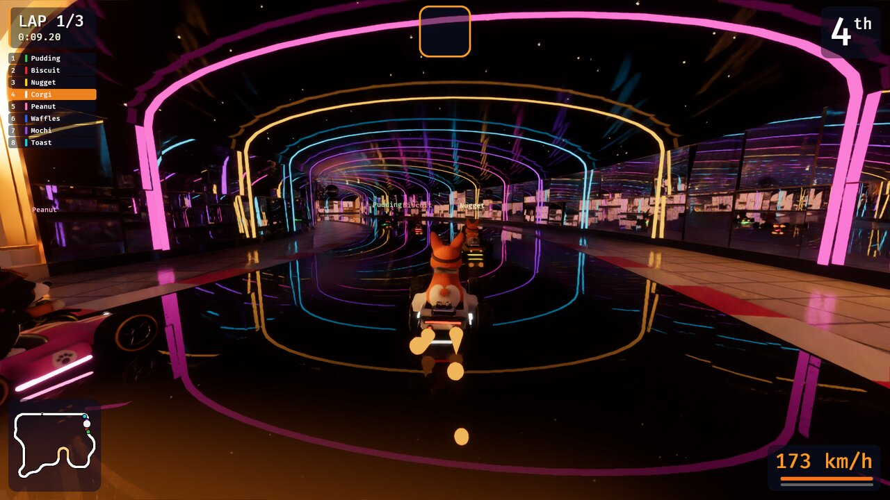
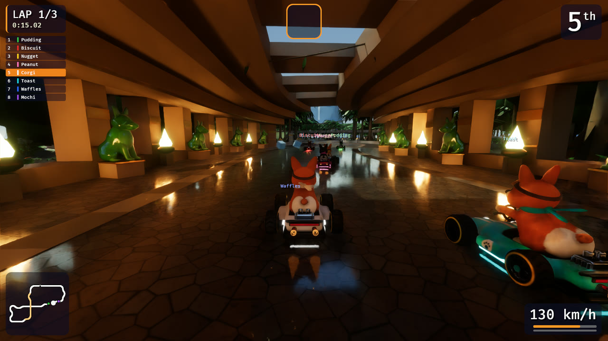
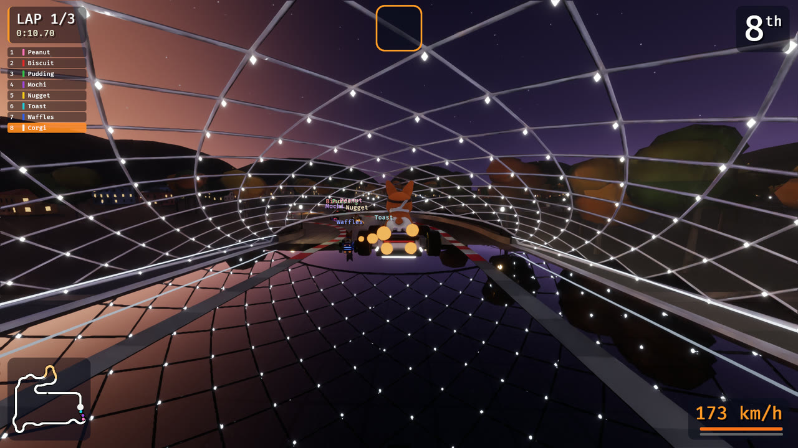
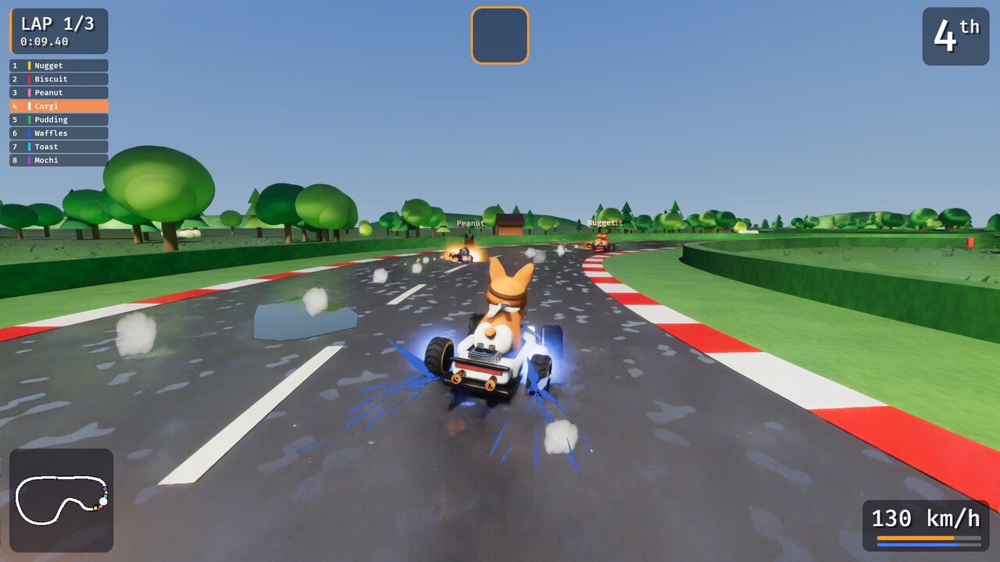
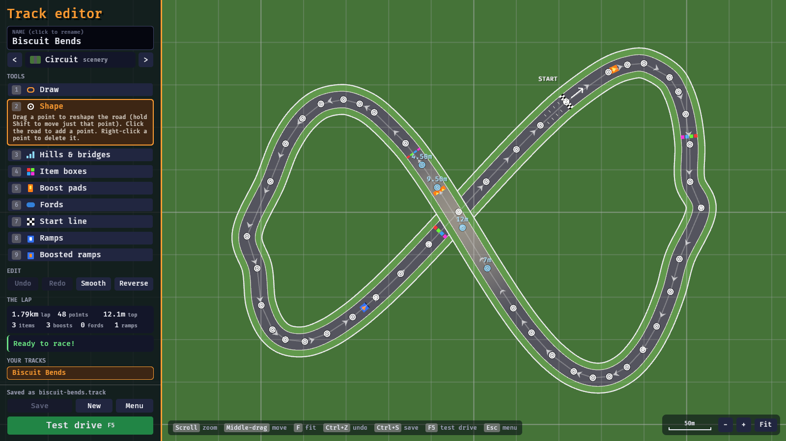
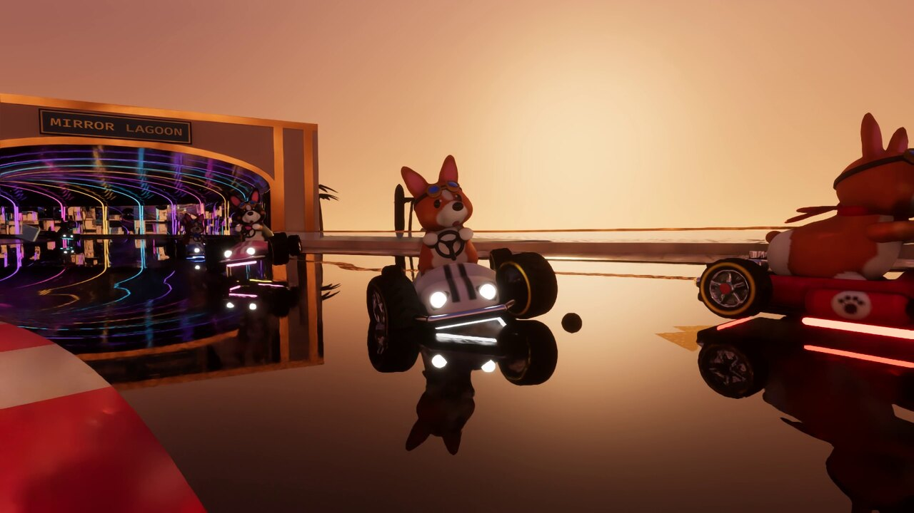
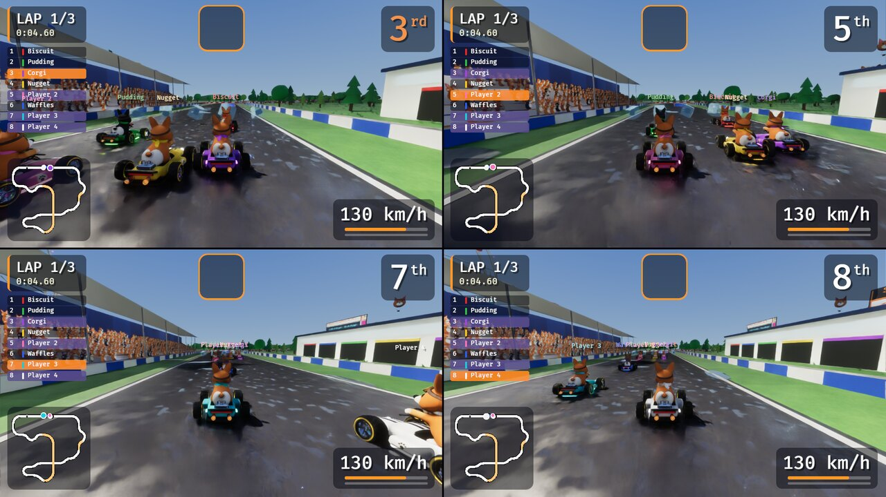

# corgiKart

A kart racer starring corgis. Written in Rust with [Bevy](https://bevyengine.org) 0.19.
Six tracks, up to 8 racers, CPU corgis, items, split-screen and LAN multiplayer, procedural
sound, and an optional hardware ray-traced renderer.



## How this was made

The code in this repository was written by AI: I built corgiKart with
[Claude Code](https://claude.com/claude-code), and didn't write the Rust by hand. I directed
the development: I decided what the game should be and what to build next, played every
build, and sent back what felt wrong, looked wrong or ran too slowly until it was right.

I made it for two reasons. It was fun, and I wanted to see how far I could take a real project
with AI coding tools: a whole game, with networking, a track editor, a ray-traced renderer and
a test suite, rather than a demo. It's here as an example of what I can do with those tools.
My other repositories are the place to look for code I wrote myself.

`CLAUDE.md` and `OPTIMIZEPERFORMANCE.md` are part of that work: they're the notes the AI works
from, on how to test the game without a window, how to measure performance, and what has
already been tried.

## Tracks

| | |
|---|---|
|  Corgi Circuit |  Prism Park |
|  Mirror Lagoon |  Jade Jungle |
|  Tbilisi Twilight |  Corgi Meadow |

- **Corgi Circuit**: a 1.9km Grand Prix circuit in the style of Suzuka, just after a rain
  shower. It's a figure of eight: the back straight flies over the lower section on a bridge,
  and has a boosted ramp on it. After the long start straight come T1, the uphill esses, the
  two Degners, a flick and a kink either side of the bridge, the hairpin, a long right into the
  double-apex Spoon, 130R, the infield esses and a final double-right. Grandstands are packed
  with about 600 cheering corgis, and there are pit garages, F1-style start lights, a Ferris
  wheel, and a giant crowned corgi statue whose head follows you round the lap. Hot-air
  balloons, a blimp, flag-waving marshals, tyre walls and gravel traps complete it.
- **Prism Park**: a night race on a road of glowing rainbow glass tiles. It has neon arches,
  glass barriers, crystal clusters, a glass corgi with a glowing heart, a climbing skyway on
  crystal pillars, a lit city skyline, lanterns and fireworks. There's also a **ford** where
  the road runs straight through the canal: you slow down a little and throw up spray, unless
  you jump most of it off the boosted ramp. T1 climbs onto the skyway, which has esses on top,
  and a steep drop takes you into a hairpin underneath it. After the ford come the far loop, esses
  along the bottom and a winding run back up to the start.
  This is the showcase track for ray tracing.
- **Mirror Lagoon**: golden hour on the Riviera, designed around what ray tracing does best.
  A low sun rakes long soft shadows down a polished terrazzo straight past the marina, where
  the sunset glitters on the water. T1 drops into the Pavilion, a curving tunnel lined with
  tilted mirror panels and neon ribs (mirrors reflecting mirrors) with a mirror ball under a
  starry vault. Then an arched causeway across a glassy lagoon lit by lamps and floating
  lanterns, which swings out into the water for a hairpin. Another hairpin goes round the
  lighthouse, then a gilded colonnade and a chicane through a harbour village of pastel houses strung with festoon lights. A chrome corgi watches from
  its island.
- **Jade Jungle**: midday in a lost temple city, a figure of eight. The trees along the road
  are crowned with hundreds of separate leaves, so with ray tracing the sun reaches the mossy
  flagstones in patches. T1 and a run of esses drop into the temple hall, a firelit gallery
  with a polished floor, gold glyph bands and jade statues between its piers. The road ducks
  under the viaduct, winds through the deep jungle to a river you can ford or jump, below a
  waterfall, then climbs onto the viaduct on its vine-hung stone columns and comes back down
  past a stepped pyramid. On top of it sits a jade corgi in a gold crown, whose head follows
  you. Stone corgi heads, stelae and fallen columns lie in the undergrowth, macaws wheel
  overhead and table mountains stand in the haze.
- **Tbilisi Twilight**: blue hour in old Tbilisi, with the afterglow behind the hills and the
  town lit by its own lights, which with ray tracing really are what lights it. From the river
  embankment T1 turns onto the Bridge of Peace, under its bowed canopy of steel and glass with
  an LED at every joint of the lattice, all mirrored in the polished deck. A loop through the
  park on the far bank brings you back over the Metekhi bridge, past its church on the rock,
  into the old town: wet cobbles under street lamps, houses with carved wooden balconies in
  every colour, festoon lights across the street, the brick domes and tiled gateway of the
  sulphur baths. Then a climb to the hairpin under Narikala fortress, floodlit on its hill
  beside the Mother of Corgis, with a cable car gliding up to it and the TV tower glittering
  on the ridge.
- **Corgi Meadow**: the original countryside loop.

Pick the track in the menu with Left/Right (the backdrop previews it). Tracks you make in the
track editor are listed after these.

## Track editor

Pick **Track editor** in the menu to draw your own tracks. It opens on the selected track if
that's one of yours, or on a blank map.



1. **Draw** (1): hold the left button and draw a loop from above, in the direction you'll race.
   It's smoothed into a road with control points, and three rows of item boxes to start with.
2. **Shape** (2): drag the points about. Neighbouring points follow a little so the road bends
   smoothly; hold Shift to move just the one point. Click the road to add a point, and
   right-click a point to delete it.
3. **Hills & bridges** (3): drag a point up or down, or scroll over it. Where the road crosses
   itself, one side has to be at least 7.5m above the other, and the higher road is drawn on top.
4. **Item boxes** (4), **Boost pads** (5), **Fords** (6), **Start line** (7), **Ramps** (8) and
   **Boosted ramps** (9): click the road to place them, drag along it for a ford, and
   right-click to remove one. Leave a straight run after a ramp to land on: a plain ramp
   carries you about 30m, a boosted one about 55m.

**Smooth** eases every bend a little, and **Reverse** races the other way round. Pick the
scenery (Circuit, Meadow, Prism, Jungle or Tbilisi) with the arrows under the name, and click the name to type a
new one. The sidebar explains the tool in use, and hovering over a button says what it does.
Anything that would stop the track being raced is ringed in red on the map, with the reason in
the sidebar: corners tighter than 15m, parts of the road closer than 40m, crossings without a
bridge, hills steeper than 1 in 5, and laps shorter than 400m or longer than 6km.

**Test drive** (F5) races it straight away, and leaving that race brings you back to the editor.
**Save** (Ctrl+S) writes it to `~/.config/corgikart/tracks/<name>.track`, a small text file,
and it appears in the menu's track list. The sidebar lists your saved tracks to open.
Ctrl+Z / Ctrl+Y undo and redo, scroll (or the buttons in the corner) zooms, middle-drag or the
arrow keys move the map, and F fits it to the window.

Custom tracks work in split screen and over LAN: the host sends the track to everyone, so
friends don't need the file.

## Engine classes

There are three classes, chosen in the menu (or `--cc 50|100|150`):

- **50cc**: a relaxed pace (80% speed)
- **100cc**: the standard speed
- **150cc**: 20% faster, with thrown items sped up to match

In a LAN lobby the host picks the track, class and CPU racers: Up/Down to choose a row,
Left/Right to change it.

## Graphics

The standard renderer is deferred, with ray-marched screen-space reflections, SSAO, contact
shadows, TAA and bloom. Wet asphalt, puddles, lake water and glossy tiles reflect the karts
and scenery, and a generated sky environment map handles everything off-screen.

**Hardware ray tracing:** `--raytracing`, or *Graphics* in the menu (takes effect on
restart). It uses Bevy's Solari renderer for ray-traced direct and indirect light, shadows and
reflections, so the neon arches, glowing tiles, windows, boost pads and every kart's
headlights, brake light bar and neon underglow actually light the scene. It needs
a GPU with hardware ray tracing (for example NVIDIA RTX). The game checks first and falls back
to the standard renderer if the GPU can't do it.



Real-time ray tracing is only clean with NVIDIA **DLSS Ray Reconstruction** denoising it.
Without DLSS it's covered in black speckles. DLSS is an optional build feature because it
needs NVIDIA's SDK, which can't be redistributed:

1. Clone the SDK and accept its license:
   `git clone --depth 1 --branch v310.5.3 https://github.com/NVIDIA/DLSS ~/sdk/DLSS`
2. Install clang and the Vulkan headers (on Linux, `VULKAN_SDK=/usr` works with the
   distribution's `vulkan-headers` package).
3. Build and run:

   ```sh
   DLSS_SDK=~/sdk/DLSS VULKAN_SDK=/usr cargo run --release --features dlss -- --raytracing
   ```

The build copies NVIDIA's DLSS runtime libraries next to the executable. If you share the
binary, include those libraries and the license text from the SDK (see the `dlss_wgpu`
README). The menu shows "Ray traced (DLSS)" when denoising is active.

Ray tracing is heavy, and its cost grows with the window's pixel count. Two settings trade
sharpness for speed, in the menu (they apply on restart) or on the command line:

- **DLSS** (`--dlss quality|balanced|performance`): renders at 67%, 58% or 50% of the window's
  width and height and lets DLSS upscale it.
- **Render resolution** (`--res native|1080p|720p`): renders the whole picture at most that tall
  and stretches it over the window. The HUD stays sharp. It works with the standard renderer and
  with split screen too.

Both stack. On a 2542x1525 window, ray traced, on AC power (fps, Circuit / Prism):

| | DLSS quality | balanced | performance |
|---|---|---|---|
| Native | 33 / 31 | | 53 / 50 |
| 1080p | 58 / 56 | 71 / 69 | 87 / 86 |
| 720p | 106 / 104 | | |

On a laptop, plug it in: on battery the GPU runs at about half speed.

## The karts

Each corgi drives a sculpted, lacquered kart in its own colour, with twin racing stripes,
paw-print roundels, treaded tyres on chrome rims, an exposed engine and twin exhausts. The
drivers wear brass racing goggles and a bandana whose tails stream out behind at speed.
Every kart has neon underglow in its colour. While you drift it changes to the spark colour
(blue, orange, then purple), and it flares when you boost. With ray tracing on, it throws
a pool of coloured light onto the road that shows up in reflections.

Everything is still built in code: textures, text on the sponsor boards, the 3D item icons
and all the sound are generated at startup. The corgis and karts are signed-distance
sculptures (`sculpt.rs`) meshed at startup. There are no asset files.

## Running

```sh
cargo run --release              # main menu
cargo run --release -- solo      # straight into a race vs CPUs
cargo run --release -- solo --players 2   # the same, split screen
cargo run --release -- host      # host a LAN game on UDP port 7777
cargo run --release -- join 192.168.1.23
cargo run --release -- editor    # straight into the track editor
```

Options: `--name <name>`, `--players <1-4>`, `--bots <0-7>`, `--port <port>`,
`--track circuit|prism|lagoon|jungle|tbilisi|meadow|custom:<file>` (a saved custom track, by its file name
without `.track`; with `editor` it opens that track), `--cc 50|100|150`, `--raytracing` / `--no-raytracing`,
`--dlss quality|balanced|performance`, `--res native|1080p|720p`, `--fps` (show the frame rate and log it to the
console), `--item <name>` / `--cpu-item <name>` (see [Items](#items)). Your name, the last address you joined, the player and CPU counts, the track, the
class, the graphics mode, DLSS and render resolution, and whether the FPS counter is on are remembered in
`~/.config/corgikart/settings.txt`.

F3, or **FPS counter** in the menu, shows the frame rate and frame time in the bottom-left
corner. Headless screenshots and benchmarks only show it with `--fps`.

### Screenshots and benchmarks without a window

`--headless` renders offscreen with no window and no sound, at `--size WxH` (default
1920x1080). Combine it with:

- `--screenshot out.png [--shot-delay secs]`: save a frame (default after 8s) and quit.
- `--bench secs`: after an 8s warm-up, measure frame times for `secs`, print a summary and the
  most expensive GPU passes, and quit.
- `--autodrive`: the AI drives your kart. `--view x,y,z,tx,ty,tz` parks the menu camera.

```sh
cargo run --release -- solo --autodrive --headless --track prism --raytracing --bench 10
```

These work with a window too (leave out `--headless`).

### Recording video, and the trailer

`--record out.mp4` renders offscreen at a steady 60 frames a second and saves a video with the
game's sound (it needs `ffmpeg`). Game time moves a sixtieth of a second per frame however long
the frame takes to render, so the video is smooth even where the game wouldn't be, and an
`--autodrive` race comes out the same every time.

- `--record-from secs` and `--record-secs secs`: which part to record (default the first 10s).
- `--cam dist,height,angle[,spin[,fov]]`: film your kart from a set place around it instead of
  the chase camera: `angle` is degrees round from behind (180 is head on) and `spin` turns it.
- `--no-hud` hides the race HUD.
- `editor --demo`: the editor builds a track by itself with a pretend mouse.

```sh
cargo run --release -- solo --autodrive --track lagoon --raytracing --no-hud \
    --cam 7,1.5,160 --record lagoon.mp4 --record-from 12 --record-secs 5
```

`python3 trailer/make.py` makes the 39-second trailer, `trailer/corgikart-trailer.mp4`: it
records each clip like this, synthesises the music (`trailer/music.py`, which needs numpy) and
cuts the clips to the beat. `--draft` does it small and without ray tracing in a few minutes.
The shot list, captions and timings are at the top of `make.py`.

## Split screen

Up to four people can race on one screen. Set **Players** in the menu (or `--players`), then
pick **Split-screen race**. Two players split the screen top and bottom; three or four get a
quarter each (with three, the spare quarter shows a live map). Everyone has their own HUD, and
CPU racers fill the rest of the grid.



Sharing a keyboard, player 1 drives with **WASD** (Space to drift, E to use an item) and
player 2 with the **arrow keys** (Right Shift to drift, Right Ctrl or Enter to use an item).
Player 1 tricks with Q, player 2 with Right Alt or /.
Gamepads go to the last players first: with one gamepad, player 2 gets it, and player 1 keeps
the keyboard. Players 3 and 4 need gamepads. The countdown shows each player their controls.

Every player's view is rendered in full, so the cost is mostly per pixel: two players at a
given window size run about 17% slower than one, and four about 27% slower.

## Playing with a friend over LAN

1. Host: pick **Host LAN game**. The lobby shows the address to share (e.g. `192.168.1.23:7777`).
2. Friend: type that address into **Host address** in the menu, then pick **Join LAN game**.
3. Host: set the number of CPU racers with Left/Right, then press Enter to start.

Both machines need the same build of the game. The host's firewall must allow
**UDP port 7777** inbound. On Linux with ufw, run `sudo ufw allow 7777/udp`.
Windows will ask the first time you host.

It's made for a network you trust. There are no passwords and nothing is encrypted, so anyone who
can reach the port can join: don't forward it to the internet.

## Controls

| Action | Keyboard | Gamepad |
|---|---|---|
| Accelerate | W | Right face button (Xbox B, Switch A) |
| Brake / reverse | S | Bottom face button (Xbox A, Switch B) |
| Steer | A D | Left stick / D-pad |
| Hop & drift | Space or Shift (hold) | RB or RT (hold) |
| Use item | E / F / Ctrl | LB or LT |
| Throw it forwards / backwards | hold Up / Down while using | hold the left stick up / down while using |
| Trick (at a ramp's lip) | Q, or drift | Top or left face button, D-pad up, a flick of the right stick, or drift |
| Leave race | Esc twice | Select twice |
| Show the frame rate | F3 | |

Gamepad buttons go by position, in the usual kart-racer layout of a Switch Pro controller, so an Xbox pad
plays the same way with the same thumb movements. In menus the left stick or d-pad moves,
the right face button confirms and the bottom one goes back.

Split screen shares the keyboard out differently: see [Split screen](#split-screen). There the
arrow keys drive player 2's kart, so keyboard players throw items the default way (hold brake to
throw a bone backwards); gamepads still aim with the left stick.

### Drifting and mini-turbos

Press drift to hop, and steer during the hop to lock into a drift in that
direction. Hold it through the corner. Sparks fly from your rear wheels and
change colour as the charge builds:

- **white**: not charged yet
- **blue**: mini-turbo (0.7s boost)
- **orange**: super mini-turbo (1.25s)
- **purple**: ultra mini-turbo (2s)

Release drift to cash in the boost. Steering *into* the drift tightens the line
and charges faster. Steering *out* widens it and charges slower. Driving on
grass stops the charge, and slamming a wall or slowing too much cancels it.

Also:

- **Rocket start**: press accelerate partway through the "1" of the countdown (not earlier).
- **Boost pads**: the glowing orange panels with arrows racing along them.
- **Ramps**: see below.
- **Fords**: shallow water caps your top speed, unless you're boosting.

### Ramps and tricks

Every track has a few kicker ramps across part of the road, so you choose whether to take
them. A plain ramp throws you about 30m; a **boosted ramp** glows with rainbow bands flowing up it
and throws you higher and about twice as far. In the air you can still steer a little, and you fly
straight over squeaky toys and thrown bones.

Press **trick** (Q, or drift) just as you leave the lip: your kart flips or rolls (steer to
pick a barrel roll either way) and you get a 1s boost when you land. The timing counts:
you have from about 0.15s before the lip to 0.2s after it, and only one try per jump. Press on
the ramp too soon and it says "Too early"; too long after takeoff and it's "Too late".

### Items

Drive through the floating item boxes. What you get depends on your place: the leader gets
things to defend with, the middle of the field gets things to throw, and the back gets the
means to catch up. The item's name is shown under its slot.

| Item | What it does |
|---|---|
| **Treat** | A speed boost. Sometimes you get three. |
| **Golden treat** | As many boosts as you can press for, for 7.5s from the first. |
| **Bone** | Thrown straight; bounces off hedges. |
| **Tennis ball** | Homes in on the kart ahead of you. |
| **Squeaky toy** | Dropped behind you as a trap. |
| **Decoy box** | A trap that looks like an item box, but for its dull red core. |
| **Water balloon** | Lobbed about 35m ahead, where it bursts: everyone within 7m spins out, and those nearest are thrown into the air. That can include you. |
| **Frisbee** | Flies round the track over everyone's heads to whoever is leading, and bursts on them like a balloon. |
| **Dog whistle** | Every other corgi cowers: they spin out, drop their items and stay small and slow for a few seconds (the leaders longest). Ordinary karts flatten small ones. |
| **Zoomies** | 7.5s of being faster, untouchable and unbothered by grass or water. Anyone you touch spins out. |
| **Squirrel!** | Your corgi tears off after a squirrel at great speed, steering itself and sending anyone in the way flying. It lasts longer the further back you are. |
| **Sausage** | You're huge for 7.5s: a little faster, flattening the karts you drive over, and shrugging off bones, balls and traps (but not bursts, the whistle, zoomies or a squirrel chase). |
| **Big woof** | Three warning barks, then one that shakes everyone ahead of you off the road: they spin out and drop their items. Anyone in the air at that moment is spared, so hop on the third bark. |
| **Mud pie** | Splatters mud over the view of everyone ahead of you for 6s. A boost blows it off sooner, and muddied CPU racers weave about. |
| **Rain cloud** | It settles over you the moment you get it, and after 10s it bursts and leaves you small, slow and itemless. Bump into someone to pass it on. Until then you're a little faster and can cut across the grass. |

Bones, tennis balls and squeaky toys also come in threes. Three bones or balls circle your
kart until you throw them: each stops one thrown item, or spins out one kart that touches it.

You can aim the throwable ones forwards or backwards, but not to the side: hold Up or Down on
the keyboard, or the left stick up or down, as you use the item. A bone goes whichever way you
aim it. A tennis ball thrown backwards flies straight instead of homing. A squeaky toy or
decoy box thrown forwards is lobbed in an arc and lands on the road about 20m ahead, where it's
a trap like any other (nothing hits it while it's in the air). A water balloon aimed backwards
is dropped behind you instead, and waits 3s or until someone touches it.

The rarest ones are rationed: no frisbee, dog whistle or big woof in the first 15s of a race,
and only one of each (and one rain cloud) at a time. In a small field the back markers are
closer to the front, so they get less help.

To try an item out, `--item <name>` keeps handing it to your kart and `--cpu-item <name>` to
the CPU racers: the name without spaces (`waterballoon`, `mudpie`), with a `3` on the end for
three (`bone3`).

## How it works

- `src/sim/`: the pure, fixed-60Hz simulation (track splines with a height profile, kart
  physics, items, AI). What an item does to a kart (size, speed, steering itself) lives in
  `kart.rs`, so a LAN client predicts it; what it does to the race, and the table of which
  items each place is offered, is in `world.rs`. `custom.rs` builds tracks made in the editor and checks them, and keeps
  the maps this game knows about by a hash of their contents, which is how LAN games agree on
  one. It has no Bevy ECS, so it's easy to test. Physics is 2D; heights only
  decide whether two things at the same spot are on the same level (the circuit's bridge).
- `src/session.rs`: solo, host and client sessions.
  - The host is authoritative and sends the full world state every tick.
  - Clients send inputs with redundancy and predict their own kart locally.
  - When a snapshot arrives, a client replays its unacknowledged inputs on top
    of it, so your kart responds instantly even with some lag.
- `src/net.rs`: UDP + bincode protocol.
- `src/render/`: everything visual.
  - `sculpt.rs`: the signed-distance sculptor behind the corgis (`corgi.rs`) and karts
    (`kart.rs`).
  - `trackmesh.rs` / `scenery.rs`: the tracks and their set pieces, rebuilt whenever the
    selected track changes. They follow the track's theme, and on custom tracks the set pieces
    go wherever they fit. Mirror Lagoon, Jade Jungle and Tbilisi Twilight each have their own
    module (`lagoon.rs`, `jungle.rs`, `tbilisi.rs`); the last two fit any layout, so the editor
    offers them as scenery. `shapes.rs` has what they're built from (strips along the road,
    tubes, domes, roofs, leaves), and a new track's scenery takes a `scene::Build`.
  - `look.rs`: per-track sky and lighting.
  - `gfx.rs`: renderer setup and the ray-tracing mesh proxies.
  - `fx.rs`: race events and particles.
  - `hud.rs` / `icons.rs`: the HUD and 3D item icons.
  - `split.rs`: split screen. Each player's camera renders into its own image, and a 2D camera
    lays those out on the window.
  - `signs.rs`: sponsor boards (Bevy UI rendered to a texture).
- `src/editor/`: the track editor. It draws the map in 2D (a vertex-coloured mesh for the road,
  gizmos for the points), with the 3D camera switched off while it's open. `files.rs` saves and
  loads tracks.
- `src/record.rs`: `--record`. Frames are piped to ffmpeg as they're captured, and the
  synthesiser is run alongside a frame's worth of samples at a time.
- `src/audio.rs`: a small synthesiser (engine, drift squeal, crowd, and one-shot effects)
  that plays through Bevy's audio as a custom source.

`cargo test --release` runs:

- geometry checks for every track (no overlaps, except the bridge with clearance)
- custom tracks: drawing a loop, the checks, saving and loading, the editor's mouse tools, CPU
  races on them, and a LAN client learning one from the host
- drift-through-every-corner checks
- every item: what it does, who it spares, and that each place is offered the right ones
- a full CPU-only race on every track
- a sanity check of the synthesiser
- a host+client LAN race over localhost, which checks that the prediction
  stays in sync with the host
- bad input: track files that would build into something enormous or into nothing, and LAN
  hosts and clients that send nonsense, are refused rather than crashing the game

## Licence

Copyright (C) 2026 Ollie Mitchelmore

corgiKart is free software: you can redistribute it and/or modify it under the terms of the
GNU General Public License as published by the Free Software Foundation, either version 3 of
the License, or (at your option) any later version.

It is distributed in the hope that it will be useful, but WITHOUT ANY WARRANTY; without even
the implied warranty of MERCHANTABILITY or FITNESS FOR A PARTICULAR PURPOSE. See the GNU
General Public License, in [LICENSE](LICENSE), for more details.

### Additional permission under GNU GPL version 3 section 7

If you modify this Program, or any covered work, by linking or combining it with the NVIDIA
DLSS SDK (or a modified version of that library), containing parts covered by the terms of
NVIDIA's DLSS SDK licence, the licensors of this Program grant you additional permission to
convey the resulting work.

That is what lets a build with `--features dlss` be shared along with NVIDIA's DLSS libraries.
Those libraries stay under NVIDIA's own licence, which you still have to follow.
